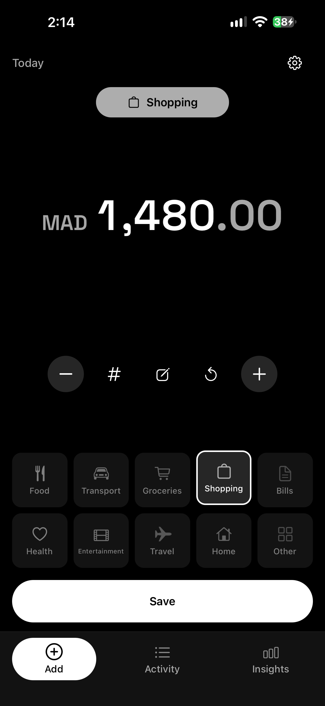
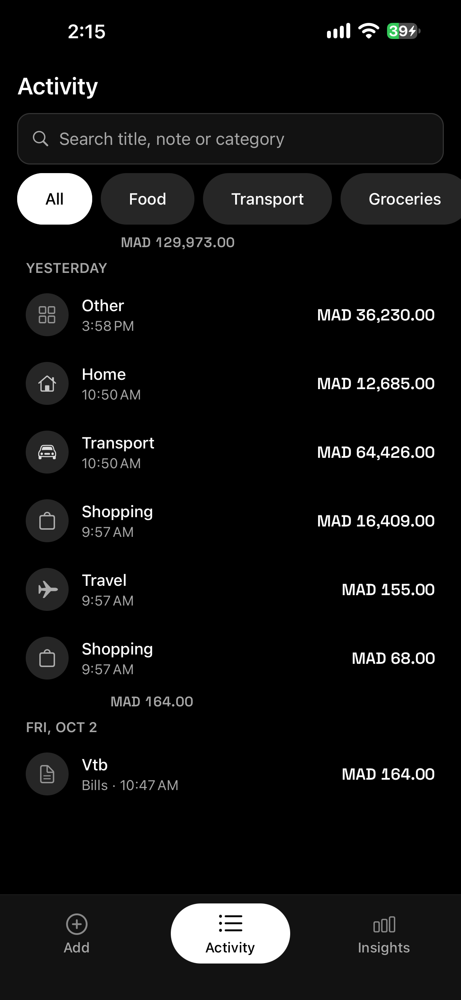
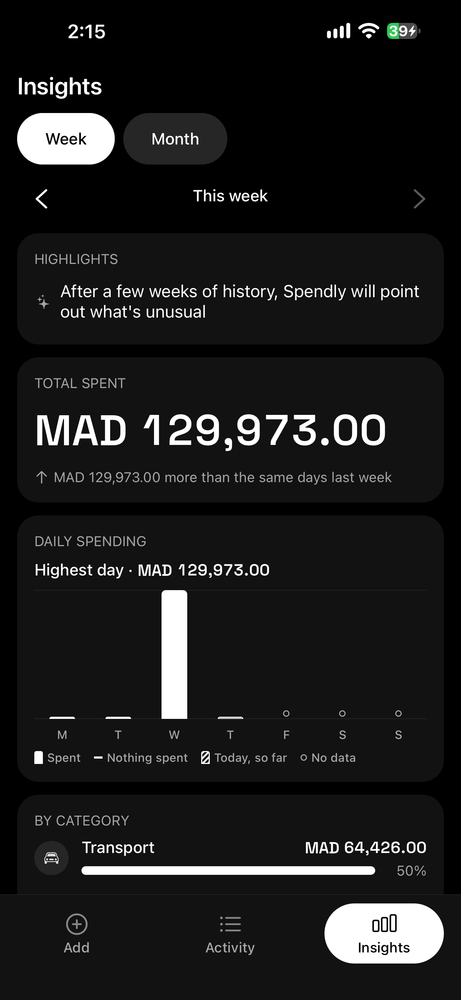
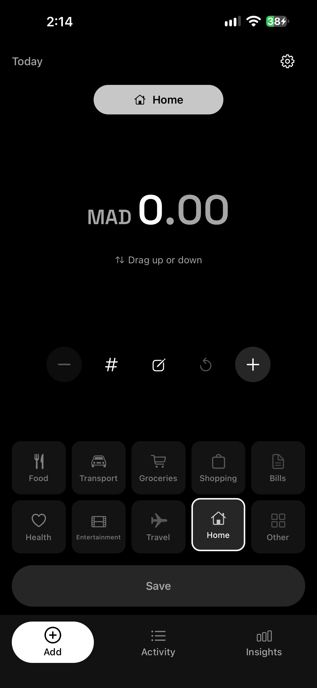
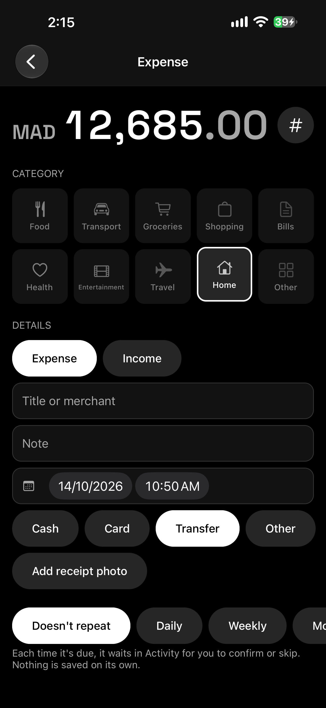
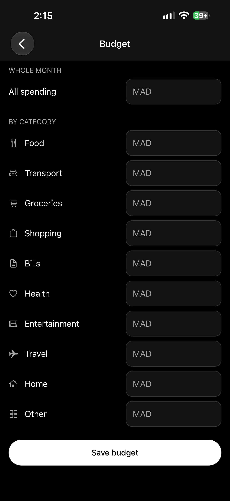
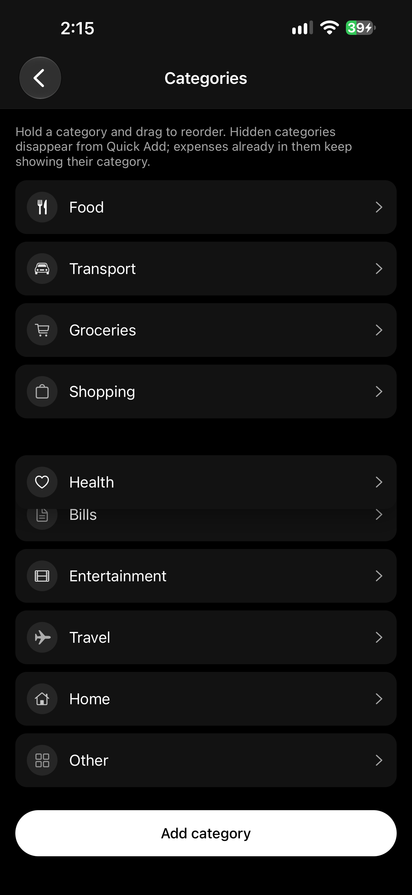
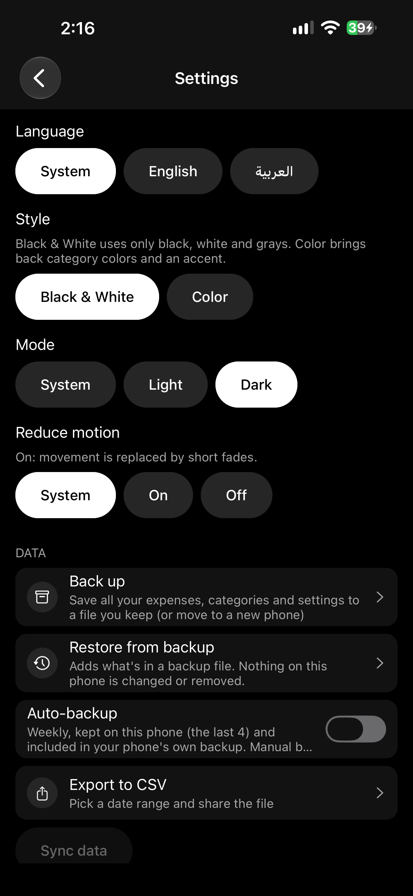

# Spendly

### Log an expense in two seconds.
**Tap a category. Drag the amount. Save.**

A fast, private expense tracker that lives entirely on your phone.
No account. No sign-up. No internet. Nothing tracked.

 

[**⬇️ Download for Android (APK)**](https://expo.dev/artifacts/eas/78Lwef2Ki2ICTnfaE5KKtVorAYvsS2iO-QFsmATP_4E.apk)
&nbsp;&nbsp;·&nbsp;&nbsp;
[**⬇️ Download for iPhone (IPA)**](https://expo.dev/artifacts/eas/1suZErq_LDu6WaYx4trSeIcmflm9b2XrogLfa_WReqo.ipa)

 

&nbsp;

&nbsp;

 

🎬 [**Watch the app in action (screen recording)**](src/media/demo.mp4)

---

## Contents

- [Install it](#install-it)
- [Adding an expense](#adding-an-expense)
- [Activity](#activity)
- [Repeating expenses](#repeating-expenses)
- [Income and budgets](#income-and-budgets)
- [Insights](#insights)
- [Monthly recap](#monthly-recap)
- [Receipt photos](#receipt-photos)
- [Categories](#categories)
- [Shortcuts, widget and quick tile](#shortcuts-widget-and-quick-tile)
- [App lock and daily reminder](#app-lock-and-daily-reminder)
- [Make it look your way](#make-it-look-your-way)
- [Settings at a glance](#settings-at-a-glance)
- [Your data stays yours](#your-data-stays-yours)
- [Back up, restore and export](#back-up-restore-and-export)
- [Feel: haptics and animation](#feel-haptics-and-animation)
- [For everyone](#for-everyone)

---

## Install it

| | Download | How to install |
| --- | --- | --- |
| 🤖 **Android** | [Spendly.apk](https://expo.dev/artifacts/eas/78Lwef2Ki2ICTnfaE5KKtVorAYvsS2iO-QFsmATP_4E.apk) | Open the link on your phone, download, and tap the file. If asked, allow installing apps from your browser. |
| 🍏 **iPhone** | [Spendly.ipa](https://expo.dev/artifacts/eas/1suZErq_LDu6WaYx4trSeIcmflm9b2XrogLfa_WReqo.ipa) | This file isn't from the App Store, so it has to be *sideloaded* with a tool like **AltStore** or **Sideloadly** and your own Apple ID. |

---

## Adding an expense

Spendly opens straight onto the **Add** screen, so you're always one tap away from logging something.

1. **Tap a category.** It flies up into place above the amount so you can see what you picked, with a light tap you can feel.
2. **Set the amount.** Drag the number **up to increase** it and down to decrease it. Move slowly for exact steps; flick to race ahead. A soft tick marks each step, and at zero or the maximum the number gently resists.
3. **Tap Save.** A short buzz, the button says **Saved**, and you're ready for the next one.

**Prefer not to drag?** Use the **− / +** buttons, the **#** keypad to type an amount, or **reset** to go back to zero.

**Your usual amounts, one tap away.** After a few entries in a category, Spendly shows the amounts you use most for it, right under the number.

**Your usual category, already picked.** Coffee every morning? Lunch at noon? When the habit is clear, Spendly picks that category for you when you open the app. Tap another one to change it.

**Made a mistake?** An **Undo** button appears for 5 seconds after every save, and it's still there even if the app closes in between.

**Today's total** is always at the top of the screen, per currency.

 

### Optional details

Tap the **details** button (✎) to add more, only if you want to:

- **Title or merchant** (e.g. "Corner café") and a **note**
- **Date and time:** defaults to now; pick an earlier moment if you forgot to log it
- **Payment method:** Cash, Card, Transfer or Other
- **Expense or Income**
- **Receipt photo**
- **Repeat:** daily, weekly, monthly or yearly

### Your entry is never lost

- Half-finished an expense and left the app? It's still there when you come back.
- If saving ever fails, your entry stays on screen with a clear message.
- If the app closes at the exact moment you save, Spendly won't create a duplicate.

---

## Activity

Everything you've recorded, newest first.

- **Grouped by day**, with a total for each day.
- **Search** by title, note or category.
- **Filter** by category with one tap.
- **Tap any expense to edit it.** Every detail can be changed.
- **Again:** swipe an expense to the side and tap **Again** to log the same thing right now.
- **Delete** asks first, then still gives you **Undo**. Deleted items stay recoverable for 30 days before they're removed for good.
- Stays smooth even with **10,000+ expenses**.

 

### Editing an expense

Change the amount, category, title, note, date and time, payment method, photo, or whether it's an expense or income. Saving a change gives you an **Undo** that puts back the previous version.

 

---

## Repeating expenses

Rent, subscriptions, the gym: set **Repeat** in an expense's details. **Spendly never saves a repeat on its own.**

- When one is due, it waits in Activity as a **pending row** (dashed outline, marked "Due") with **Confirm** and **Skip** right on it.
- Pending rows never count in totals, Insights or exports until you confirm them.
- Away for a while? Each missed one is shown (up to 3 months back), with **Confirm all** / **Skip all**.
- A repeat on the 31st falls on the last day of shorter months, then comes back to the 31st.

---

## Income and budgets

**Income:** switch any entry to **Income**. It shows a "+" and never counts as spending. When you've logged income, Insights shows a **Net** card: what's left over, or how much more you spent than you earned.

**Budgets** (Settings → Budget): set a monthly amount for all spending and, if you like, for each category. In the month view of Insights, a thin bar tells you in plain words how you're doing, like *"€120 left of €500"*. No nagging popups.

 

---

## Insights

A quick, honest look at where your money goes.

**Highlights come first:** up to three short sentences about what's different, like *"Food is up 45% compared with your usual week"* or *"Biggest day: Saturday, €82.00"*. Tap one to see those expenses.

- **"Usual" means *your* usual:** your typical spending over the last 8 weeks or months, not just last week.
- **No drama over small amounts.** Going from €2 to €4 is not "up 100%".
- **Honest when there's nothing to say.** Until you have a few weeks of history, Spendly doesn't call anything unusual.

Also on this screen:

- **Week** or **Month**, and step back through earlier periods.
- **Total spent**, and a fair **comparison** with the same days last time.
- **Daily spending chart:** tap a day for its amount. "Spent nothing" and "no data yet" look different, so they're never confused.
- **Spending by category**, with each share and whether it's up, down or about usual.
- **Several currencies?** Kept separate, never converted.

 

---

## Monthly recap

At the start of each month, Insights shows a **recap card** for the month that just ended: total, top category, biggest day and how it compared with usual. Tap **Share** to send it as an image. Past recaps are one step back in the month view.

---

## Receipt photos

Keep the proof with the expense. In the details, tap **Add receipt photo** and take a picture or pick one from your gallery. Tap the thumbnail to see it full screen. Photos stay on your phone and are included in your backups.

---

## Categories

Spendly comes with 10 categories: **Food, Transport, Groceries, Shopping, Bills, Health, Entertainment, Home, Travel and Other.**

Open **Settings → Categories**, or press and hold a category on the Add screen, to make them yours:

- **Reorder:** hold a category and drag it. The others slide out of the way.
- **Add your own** with a name, one of 20 icons and one of 10 colors.
- **Rename and restyle** any category, built-in ones included.
- **Hide** the ones you don't use. Past expenses keep showing their category.
- **Restore defaults** any time. Your own categories are kept.

 

---

## Shortcuts, widget and quick tile

Log something without hunting for the app.

- **Quick log** (Settings → Quick log and shortcuts): set your most common expense once, like *"20 Food"*, then log it in a single tap.
- **Siri and Shortcuts (iPhone):** add a Spendly shortcut to log an amount and category, or just open Add ready to go.
- **Home-screen widget (Android):** today's total at a glance; tap it to add an expense.
- **Quick settings tile (Android):** pull down your notification shade and tap **Quick log**.

Everything logged this way appears in Activity with **Undo**, just like a normal save.

---

## App lock and daily reminder

Both are **off by default**.

- **App lock:** protect Spendly with Face ID, fingerprint or your phone's passcode. The app locks when you leave it, with an optional 1-minute grace period. If biometrics stop working, your passcode always gets you in. You're never locked out of your own data.
- **Daily reminder:** a gentle nudge at the time you choose, **skipped on days you've already logged something**. Tap it to go straight to Add.

---

## Make it look your way

- **Style:** **Black & White** (the default, only black, white and grays) or **Color** (category colors plus an accent: lime, blue, violet, coral, teal or amber).
- **Mode:** System, Light or Dark, for either style. Every change fades smoothly.
- **Language:** System, English or **العربية**. In Arabic the whole app reads right to left.
- **Reduce motion:** movement is replaced by soft fades.

 

---

## Settings at a glance

| Setting | What's there |
| --- | --- |
| **Categories** | Reorder, hide, rename or add your own |
| **Money** | Currency (starts as your region's), budget, drag sensitivity (Precise / Balanced / Fast), amount step (1, 5, 10 or 50) |
| **Quick Add** | Haptics on or off |
| **Quick log and shortcuts** | Your one-tap expense, and links for Siri / Shortcuts |
| **App lock** | Face ID, fingerprint or passcode |
| **Daily reminder** | On or off, and its time |
| **Appearance** | Language, style, accent, light/dark mode, reduce motion |
| **Data** | Back up, restore, auto-backup, export to CSV, *Sync data (coming soon)* |
| **About** | Replay the introduction, version |

Every setting applies instantly and is remembered.

---

## Your data stays yours

- 🔒 **No account, no sign-up.**
- ✈️ **Works fully offline.** Airplane mode changes nothing.
- 🙈 **Nothing is uploaded or tracked.** Every expense, photo and setting is stored only on your phone.
- 📤 Your data leaves the device **only when you share it yourself.**

### Built not to lose anything

- If the app or phone shuts down mid-save, you never get half an expense or a duplicate.
- If your storage is full, Spendly says so clearly and keeps what you typed.
- Every time it opens, Spendly checks its data. If something's wrong, it leaves the file untouched and tells you, so you can restore a backup.

---

## Back up, restore and export

- **Back up:** saves all your expenses, categories, photos and settings to one file. Keep it in Files, iCloud Drive, Google Drive, or email it to yourself.
- **Restore from backup:** on a new phone, brings everything back. It only **adds** what's missing: nothing on your phone is changed or removed, and restoring twice never creates duplicates. The whole file is checked first; if any part is damaged, nothing is restored.
- **Auto-backup** (off by default): a weekly backup kept on your phone (the last 4), included in your phone's own iCloud or Google backup. Settings shows the date of the last one, and you can share the latest at any time.
- **Export to CSV:** a spreadsheet of your expenses for **this month, the last 3 months, this year or all time**. Open it in Excel, Numbers or Google Sheets.

---

## First launch

A short, hands-on introduction shows you the three steps (tap a category, set the amount, save) on a practice screen. Nothing is saved while you practise. **Skip** it any time, and replay it from Settings → About.

---

## Feel: haptics and animation

| When you… | You feel |
| --- | --- |
| Pick a category | A light tap |
| Drag the amount | A soft tick at each step |
| Hit zero or the maximum | A firmer tap |
| Save an expense | A short success buzz |
| Reorder a category | A tick as it passes each one |

Everything on screen moves smoothly instead of jumping: each digit of an amount rolls to its new value, lists slide when items move, and screens glide in and out. Turn haptics off in Settings, or turn on **Reduce motion** for gentle fades.

---

## For everyone

- Works with **VoiceOver** and **TalkBack**: every control has a clear spoken name, and saving, deleting and undoing are announced out loud.
- **Nothing requires dragging.** Every drag has a button alternative.
- Supports **large text sizes** without cutting anything off.
- **Color is never the only signal.** States use shapes, labels and icons too, so Black & White loses nothing.
- **Speaks your format:** currency symbols, decimals, dates and the first day of the week follow your phone's region.
- **English and Arabic**, with a full right-to-left layout in Arabic.

---

**Spendly** · made to be the quickest way to know where your money goes.

[⬇️ Android APK](https://expo.dev/artifacts/eas/78Lwef2Ki2ICTnfaE5KKtVorAYvsS2iO-QFsmATP_4E.apk) &nbsp;·&nbsp; [⬇️ iPhone IPA](https://expo.dev/artifacts/eas/1suZErq_LDu6WaYx4trSeIcmflm9b2XrogLfa_WReqo.ipa)

